# 🎬 SceneUI Pro: Autonomous AI Cinema & Multi-GPU Narrative Video Workstation

[](https://fastapi.tiangolo.com/)
[](https://github.com/comfyanonymous/ComfyUI)
[](README.md)
[](https://github.com/m-bain/whisperX)
[](https://ffmpeg.org/)
[](README.md)

An end-to-end autonomous video production workstation designed for creating high-retention, faceless YouTube animations, explainer series, and narrative documentaries. 

SceneUI Pro unifies local and remote LLM orchestration, multi-character identity anchoring, zero-shot voice synthesis, distributed ComfyUI image-to-video diffusion, automatic WhisperX sub-second timeline synchronization, and non-linear audio/video post-production inside a single reactive studio.

---

## 📺 Video Demos & Production Showcase

Watch the autonomous production workstation in action and the master 1080p rendered result directly below:

### 🎬 Studio Workflow & Multi-GPU Pipeline (1m 45s Walkthrough)
https://github.com/user-attachments/assets/69d44ea0-e255-4b51-9e5a-bd452480897a

> 🎥 **Studio Walkthrough**: Demonstrates end-to-end workflow: raw story script decomposition with LLM, character casting & identity locking, batch multi-GPU visual diffusion, sub-second WhisperX phoneme alignment, and non-linear audio mastering.

<br>

### 🎞️ Master Animation Result (55s Showcase)
https://github.com/user-attachments/assets/35326395-1c1f-4b98-bc22-0bef39a679df

> 🍿 **Final Animation**: Complete 1080p cartoon narrative generated autonomously by SceneUI Pro, featuring locked stickman visual identity, synchronized voiceover narration, diegetic Foley sound effects, dynamic BGM auto-ducking, and automated ASS captions.

---

## 🧭 Complete Production Pipeline: From Story to Master Render

SceneUI Pro eliminates fragmented workflows between multiple disjointed tools. The production follows an integrated multi-tab pipeline:

```
[1. Script & LLM] ──▶ [2. Character Casting] ──▶ [3. Voice & Audio] ──▶ [4. Visual Engine] ──▶ [5. Video Studio] ──▶ [6. Timeline Sync] ──▶ [7. Post-Production & Render]
```

```
                               ┌─────────────────────────────────────────────────────────────┐
                               │                    1. RAW SCRIPT INPUT                      │
                               │        Story text, dialogue, pacing & style selection       │
                               └──────────────────────────────┬──────────────────────────────┘
                                                              │
                                                              ▼
                               ┌─────────────────────────────────────────────────────────────┐
                               │                 LLM DIRECTING ENGINE                        │
                               │     (Local Ollama / OpenAI GPT-4o / Google Gemini Flash)    │
                               ├──────────────────────────────┬──────────────────────────────┤
                               │                              │                              │
                               │ (Mode A: Cast Extraction)    │ (Mode B: Scene Matrix)       │
                               ▼                              ▼                              │
             ┌───────────────────────────────────┐    ┌───────────────────────────────────┐  │
             │   CHARACTER VISUAL PROFILES       │    │     18-SCENE MATRIX BREAKDOWN     │  │
             │ Prompt anchors, traits, clothing  │    │ Image & video prompts, camera     │  │
             └─────────────────┬─────────────────┘    │ angles, refA/refB bindings        │  │
                               │                      └─────────────────┬─────────────────┘  │
                               │                                        │                    │
                               ▼                                        │                    │
             ┌───────────────────────────────────┐                      │                    │
             │    2. CHARACTER CASTING HUB       │                      │                    │
             │ Base DNA templates, inpainting    │                      │                    │
             │ custom upload & identity locking  │                      │                    │
             └─────────────────┬─────────────────┘                      │                    │
                               │                                        │                    │
                               │ [Locked Character References]          │                    │
                               └───────────────────────┬────────────────┘                    │
                                                       │                                     │
                                                       ▼                                     │
                                     ┌───────────────────────────────────┐                   │
                                     │     3. VOICE & AUDIO STUDIO       │                   │
                                     │ Multi-speaker voice clone/design  │◀──────────────────┘
                                     │ Chunking by scene & master stitch │
                                     └─────────────────┬─────────────────┘
                                                       │
                                                       ▼
                                     ┌───────────────────────────────────┐
                                     │   4. DISTRIBUTED VISUAL ENGINE    │
                                     │ Multi-GPU Farm & Nano Banana API  │
                                     │ Batch image generation + VAE live │
                                     └─────────────────┬─────────────────┘
                                                       │
                                                       ▼
                                     ┌───────────────────────────────────┐
                                     │    5. BATCH VIDEO STUDIO (I2V)    │
                                     │ MiniMax H3 / Wan2.1 / SVD motion  │
                                     │ Diegetic Foley sound integration  │
                                     └─────────────────┬─────────────────┘
                                                       │
                                                       ▼
                                     ┌───────────────────────────────────┐
                                     │   6. TIMELINE & WHISPERX SYNC     │
                                     │ Sub-second phoneme & word timings │
                                     │ Automatic scene duration snapping │
                                     └─────────────────┬─────────────────┘
                                                       │
                                                       ▼
                                     ┌───────────────────────────────────┐
                                     │   7. MASTER POST-PRODUCTION &     │
                                     │             RENDER                │
                                     │ BGM ducking, SFX mixer, animated  │
                                     │ captions, LUTs ➡️ 1080p Master MP4│
                                     └───────────────────────────────────┘
```

---

## 📸 Visual Production Walkthrough

### 1. Script Decomposition & LLM Auto-Director
The workflow begins by pasting the narrative script into **1. Script & LLM** and selecting the target visual art style.
* **Hybrid LLM Inference:** Seamlessly toggle between local zero-cost models (via Ollama: Qwen 2.5 32B, Llama 3.3) and high-speed Cloud APIs (OpenAI GPT-4o-mini / GPT-4o, Google Gemini 3.1 Flash / Pro).
* **Mode A (Extract Characters):** Automatically decomposes the script to identify cast members, generating isolated prompt profiles, base templates, and negative prompts.
* **Mode B (Generate Scenes):** Decomposes the story into a sequence of scenes (e.g., 18 scenes), generating camera framing parameters (wide establishing, low-angle, medium close-up), dynamic motion prompts (`video_prompt`), dialogue lines, and character reference bindings (`refA`, `refB`).

| Script Input & Character Extraction | Generated Scene Matrix JSON |
| :---: | :---: |
| 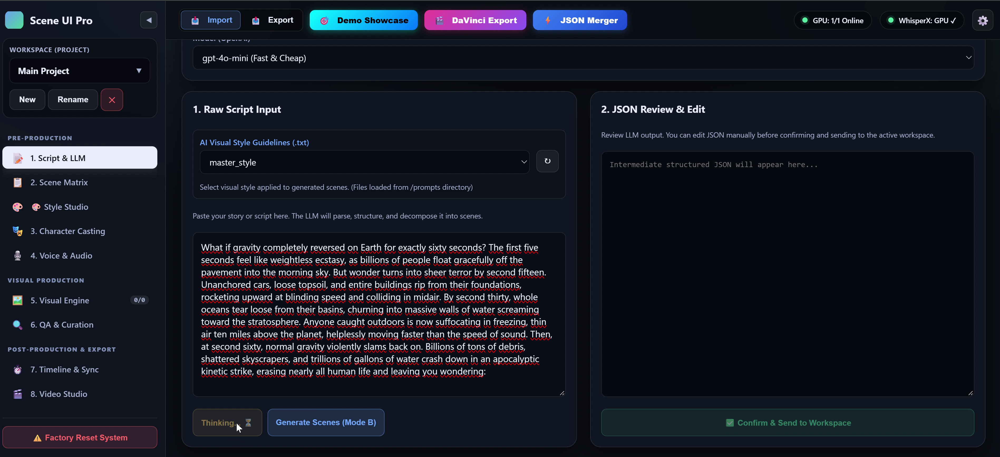 | 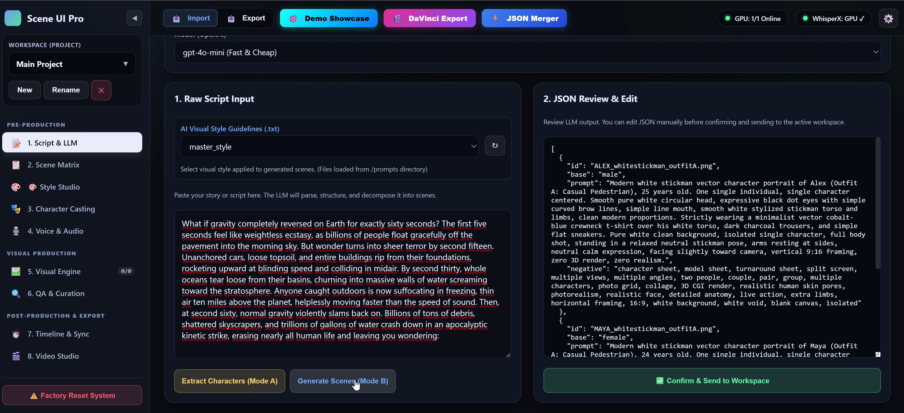 |

---

### 2. Scene Matrix Table & Parameter Inspection
The structured output is reviewed in **2. Scene Matrix**. Every scene's visual prompt, negative prompt, camera perspective, assigned dialogue, and character reference anchors can be adjusted inline before triggering synthesis.

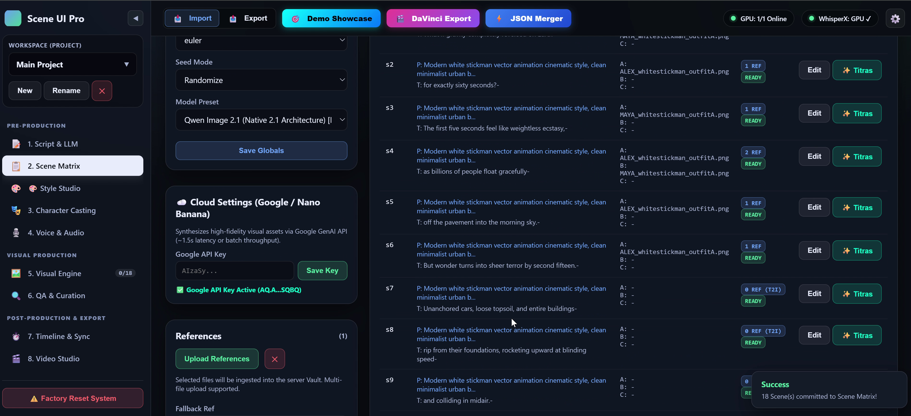

---

### 3. Character Casting & Visual Identity Anchoring
In **3. Character Casting**, the system synthesizes consistent full-body visual anchors for every character using base template proportions (`base_male`, `base_female`, `base_teen`, `base_kid`).
* **Generation & Custom Uploads:** Characters can be generated from scratch, synthesized from reference images, or uploaded manually.
* **Iterative Refinement:** Built-in inpainting and prompt adjustments allow fine-tuning until the visual character identity is locked. These references are injected into all downstream scenes to maintain visual consistency.

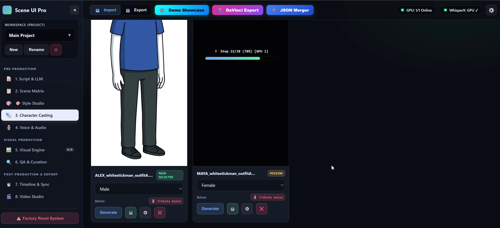

---

### 4. Voice Casting & Multi-Speaker Audio Synthesis
In **4. Voice & Audio**, the script dialogue is parsed into audio chunks per scene.
* **Voice Library & Cloning:** Users can select saved voice profiles, design new synthetic voices, or clone voices from sample WAV files.
* **Multi-Speaker Dialogues:** Different voices can be assigned to different characters (e.g., Alex vs. Maya).
* **Master Dialogue Stitching:** Synthesizes individual scene audio files (`chunk_s1.wav` ... `chunk_s18.wav`) and automatically stitches them into a master dialogue track (`default_full_script_dialogue.wav`) with crossfades.

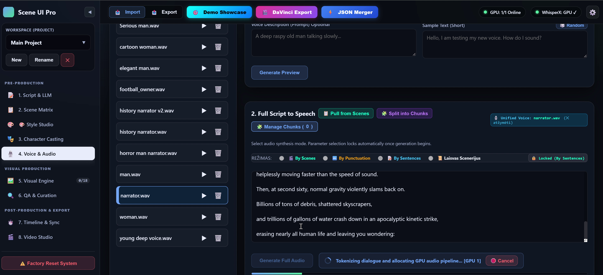

---

### 5. Visual Engine: Batch Image Synthesis & Live GPU Telemetry
In **5. Visual Engine**, all scenes are populated and rendered using the character reference anchors and scene prompts.
* **Dual Inference Pipeline (Local Farm vs. Cloud API):**
  * **Local GPU Cluster:** Qwen Image 2.1 native diffusion running on local/remote ComfyUI instances with latent upscaling.
  * **Cloud Fast-Path (Nano Banana 2 Flash):** High-speed Cloud API integration (`nano_banana_2_flash`) for lightning-fast character and scene generation when local VRAM is constrained.
* **Live Progress Telemetry:** Real-time VAE decoding percentages, step progress bars, and assigned GPU worker indices stream directly to each scene card.
* **Variations & Overlays:** Every scene supports unlimited variations, quick regeneration (`↻`), horizontal mirror flipping (`🪞`), and manual parameter editing.

| Live Batch GPU Generation | Completed Scene Illustration Matrix |
| :---: | :---: |
| 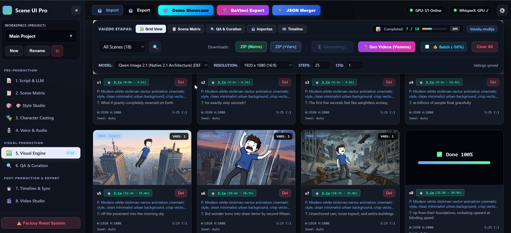 | 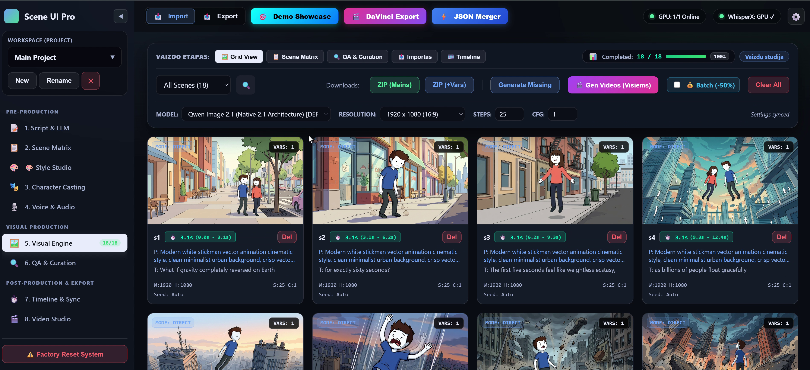 |

---

### 6. Image-to-Video (I2V) Motion Studio & Inspection
Static keyframes can be converted into animated video sequences.
* **Batch Video Modal:** Provides a one-click modal to generate videos for all or missing scenes, with selectable Foley sound integration.
* **Video Inspection & Trimming:** Inspect generated 24fps MP4 clips in the fullscreen viewer (`09`) or trim clip durations using the interactive video trimmer (`✂️`).

| Batch Video Generation Modal | Fullscreen Video Inspector & Variations |
| :---: | :---: |
| 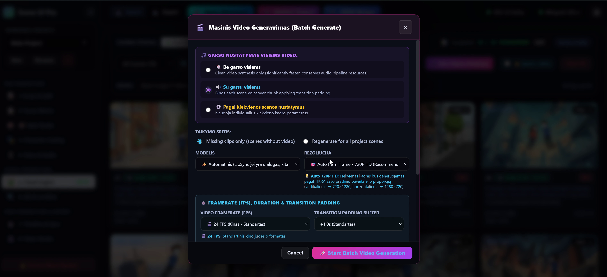 | 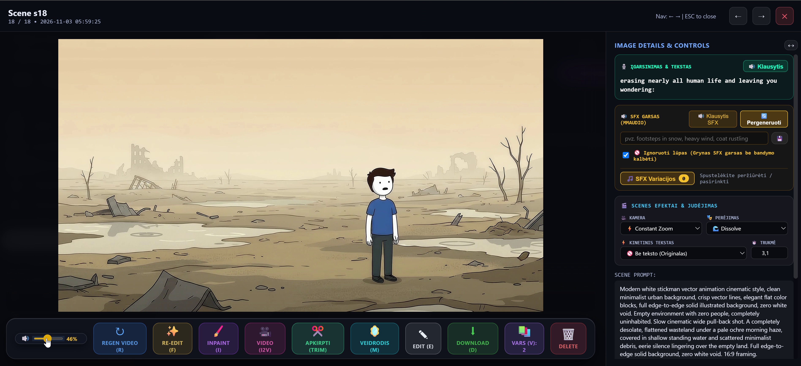 |

---

### 7. Timeline & WhisperX Sub-Second Synchronization
In **7. Timeline**, speech audio and visual scenes are synchronized.
* **WhisperX Phoneme Alignment:** Aligns the master dialogue track down to word and phoneme timestamps.
* **Automatic Scene Duration Locking:** Automatically recalculates and locks the duration of each scene card to match the exact spoken dialogue window.

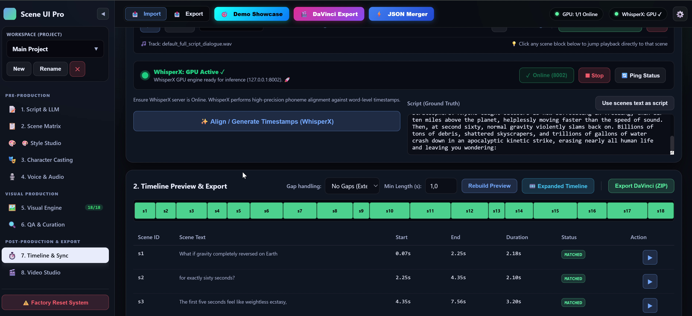

---

### 8. Post-Production: BGM Studio, SFX Foley Mixer & Captions
The system integrates non-linear post-production tools directly in **8. Video Studio**:
* **🎵 BGM Waveform Studio:** Interactive waveform scrubber, in/out trimming, fade curves, and automatic speech ducking.
* **🔊 Scene SFX & Foley Audio Mixer:** Per-scene volume sliders, mute controls, and diegetic sound balancing.
* **✨ Animated Word Captions & LUTs:** Dynamic karaoke-style highlighted subtitles and cinematic color grading presets (Original, Teal & Orange, Vintage Film, Cyberpunk).

| BGM Studio Waveform Editor | Scene SFX & Foley Audio Mixer | Transitions, Captions & LUTs |
| :---: | :---: | :---: |
| 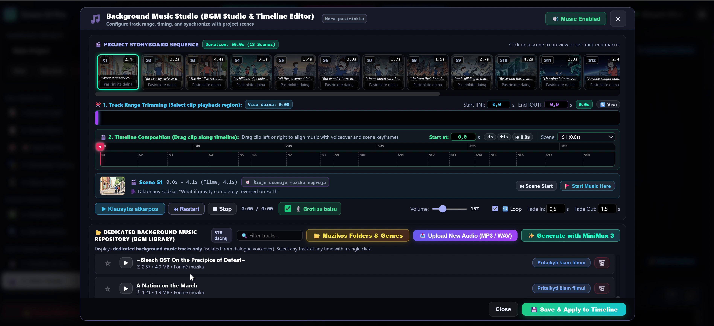 | 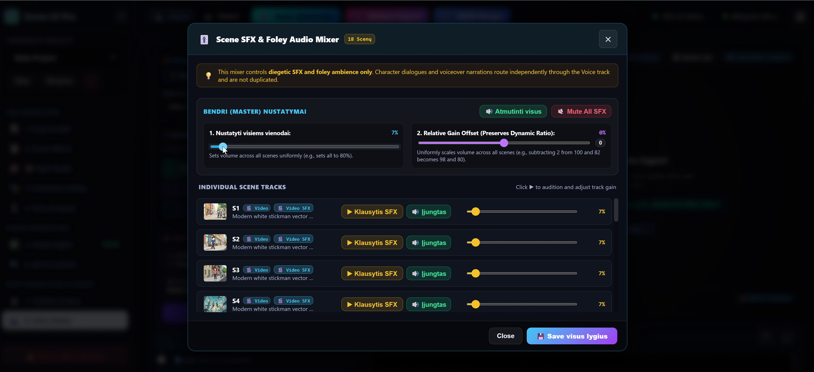 | 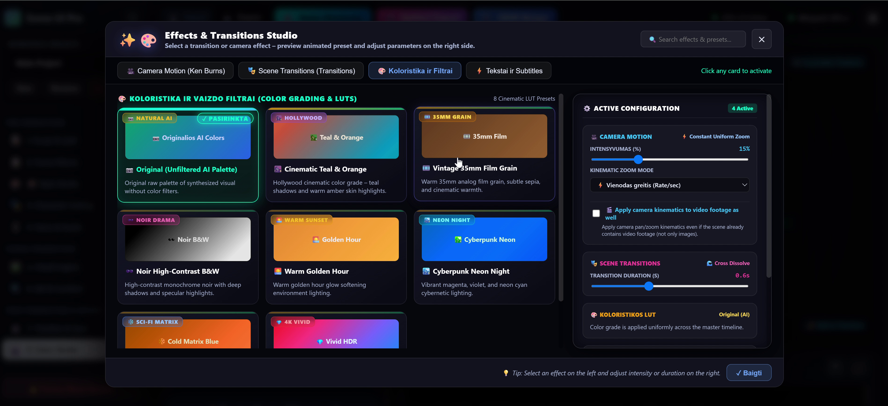 |

---

### 9. Master Video Rendering & Playback
The user clicks **Render Master Video**. The hardware-accelerated NVENC engine composites the video frames, audio tracks, BGM, SFX sub-mixes, and animated subtitles into a final 1080p MP4 master animation.

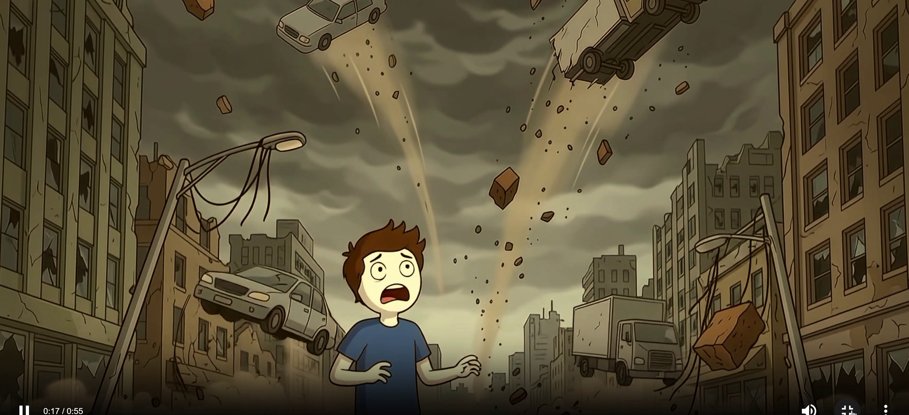

---

## 🎨 Advanced Visual DNA & Custom Style Creator

SceneUI Pro includes an autonomous style extraction and creation subsystem:
1. **Custom Style Creator:** Define custom art styles, negative prompt filters, and LoRA trigger weights, saved directly to the permanent style library.
2. **YouTube Style Extractor (Visual DNA):** Input a public YouTube reference video URL. The engine downloads frames, extracts visual features (color palettes, line weights, shading, architectural themes), and compiles them into a reusable style preset for future video productions.

---

## ⚡ Technical Architecture, Models & Distributed Engine

SceneUI Pro is built as a distributed client-server production environment:

```
┌────────────────────────────────────────────────────────────────────────────────────────┐
│                                 FASTAPI CORE BACKEND                                   │
│  - WebSocket Telemetry Hub   - Task History Manager   - Multi-Node Load Balancer       │
│  - SQLite WAL Request Queue  - WhisperX Subsystem     - Hardware FFmpeg Muxer          │
└──────────────────────────────────────────┬─────────────────────────────────────────────┘
                                           │
                ┌──────────────────────────┴──────────────────────────┐
                ▼                                                     ▼
┌───────────────────────────────┐                     ┌───────────────────────────────┐
│     LOCAL WORKER NODE #1      │                     │     REMOTE CLOUD NODE #2      │
│  (e.g., RTX 4090 / 24GB VRAM) │                     │  (e.g., RunPod / Cloud API)   │
│  - ComfyUI Instance (:8188)   │                     │  - Nano Banana 2 Flash API    │
│  - Qwen Image 2.1 Native      │                     │  - MiniMax H3 Video / Wan2.1  │
│  - Latent Upscaler / LoRA     │                     │  - MMAudio Video SFX          │
└───────────────────────────────┘                     └───────────────────────────────┘
```

### 1. Model Specifications & Workflows
* **Visual Synthesis (T2I / Latent Upscale):**
  * `image_qwen_image_2_1.json`: Native Qwen Image 2.1 architecture for visual generation and prompt adherence.
  * `qwen_image_latent_upscale.json`: Multi-pass latent diffusion upscaling for high-frequency detail.
  * `qwen_image_edit_2511_systms_action.json`: Targeted inpainting and character modification workflow.
  * `nano_banana_2_flash`: Cloud API model preset for instantaneous cloud rendering.
* **Image-to-Video Diffusion (I2V):**
  * `18_MiniMax_H3_Vientisas_Kadras_Gyva_Scena_Tikslus_LipSync_api.json`: High-motion temporal diffusion with character consistency and lip synchronization.
  * Support for Wan2.1, Stable Video Diffusion (SVD), and CogVideoX pipelines.
* **Audio, Foley & Speech Synthesis:**
  * `qwen_tts_clone.json` & `qwen_tts_design.json`: Few-shot voice cloning and synthetic persona design.
  * `19_MMAudio_Video_Arba_Vaizdo_I_Scenos_Garsus_SFX_api.json`: Video-to-audio Foley synthesis generating diegetic ambient noise, footsteps, and environmental impacts.
  * `music_minimax_3.json`: Background music composition engine.
* **Speech-to-Text & Alignment:**
  * **WhisperX:** Batched phoneme-level forced alignment calculating millisecond-accurate subtitle timings and scene durations.

### 2. Multi-GPU Farm Load Balancing & Task Management
* **Distributed Node Discovery:** Supports connecting arbitrary numbers of local GPUs and remote cloud instances (RunPod, Lambda, Vast.ai) via ComfyUI HTTP/WebSocket APIs.
* **SQLite WAL Queue Manager:** Lock-free SQLite database with Write-Ahead Logging (WAL) coordinating request distribution, priority queues, and node health heartbeats.
* **Task History & Telemetry:** Detailed task history tracks prompt variations, seeds, generation durations, and failure recovery. If a worker node disconnects mid-render, tasks are automatically failed over and requeued to an idle GPU.
* **Hardware Muxing Pipeline:** FFmpeg hardware-accelerated encoding using NVIDIA NVENC (`h264_nvenc` / `hevc_nvenc`) and Intel QuickSync for instantaneous master compositing.

---

## 🔒 Security & Intellectual Property Notice

* **Showcase Release:** This repository is published as a technical architecture portfolio showcase.
* **Proprietary Workflows & Engine:** Core internal engine code, proprietary ComfyUI workflow JSON structures, and training models remain private intellectual property.
